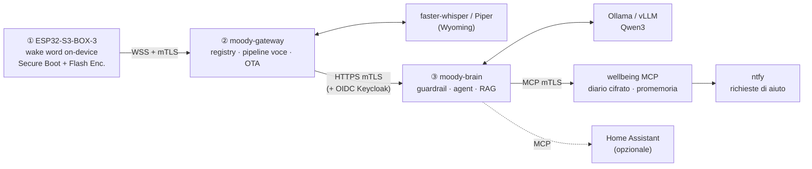

# Moody · assistente vocale per il benessere, open source e privacy by design

**Moody** è un assistente vocale per il benessere quotidiano, pensato per **casa** e per le
strutture **senior living** (un dispositivo per ogni residente). È la replica open source di un
[progetto basato su ESP32‑S3 e Microsoft Foundry](https://lnkd.in/p/deEm-kBN): stessa architettura
a tre livelli (Edge ⇄ Execution ⇄ Intelligence), con ogni componente Microsoft sostituito da
software **open source, self‑hosted e senza cloud**.

- 🎙️ Wake word **"Hi ESP" riconosciuta sul dispositivo**: prima di quel momento nessun suono lascia la stanza
- 🔐 **mTLS ovunque** con PKI privata a due CA, **Secure Boot V2 + Flash Encryption + NVS encryption**, OTA firmata
- 🧠 LLM **locale** (Ollama/vLLM + Qwen3, Apache‑2.0), speech locale (faster‑whisper + Piper)
- 🛡️ Guardrail deterministici per crisi ed emergenze, policy dei tool **deny‑by‑default**, red teaming incluso
- 💚 Funzioni di benessere: check‑in dell'umore *dichiarato*, promemoria, esercizi di respirazione,
  informazioni sulle attività, richiesta di aiuto a un familiare o allo staff
- ⚖️ Licenza **MIT**, con dipendenze scelte in modo consapevole ([analisi licenze](docs/10-licenze.md))

> ⚠️ **Moody non è un dispositivo medico** e **non sostituisce il 112** né i sistemi di chiamata
> d'emergenza certificati. Non fa diagnosi, non dà indicazioni su farmaci o dosaggi e non deduce
> emozioni da voce o comportamento.

---

## Architettura in breve



| Progetto originale (Microsoft) | Moody (open source) |
|---|---|
| ESP32‑S3 / SenseCAP, "Hi ESP", Secure Boot, Flash Encryption | ESP32‑S3‑BOX‑3, firmware ESP‑IDF proprio, ESP‑SR WakeNet9, Secure Boot V2, Flash Encryption, NVS encryption, OTA firmata |
| Python sandbox con WebSocket mTLS | `moody-gateway`: WSS mTLS, registry con revoca, nessun accesso generico alla rete di casa |
| Microsoft Foundry (LLM, agent, knowledge) | `moody-brain` + Ollama/vLLM + Qwen3, RAG locale (bge‑m3 + SQLite) |
| MCP per la smart home | MCP (SDK ufficiale): server `wellbeing` + server MCP di Home Assistant |
| Microsoft Entra ID | PKI privata (due CA) + Keycloak (OIDC) |
| Foundry guardrails / prompt shields | Guardrail deterministici + IBM Granite Guardian (opzionale) |
| Foundry AI Red Teaming | Harness `redteam/`, promptfoo, garak |

Dettagli: [docs/00-architettura.md](docs/00-architettura.md).

---

## 🛒 Lista della spesa

Prezzi indicativi (novembre 2026). Elenco completo, alternative e dimensionamento in
[docs/01-acquisto.md](docs/01-acquisto.md).

### Casa (1 dispositivo)

| Componente | Q.tà | Prezzo indicativo | Note |
|---|---|---|---|
| **ESP32‑S3‑BOX‑3** (kit con BOX‑3‑DOCK) | 1 | 50–60 € | Display touch, 2 microfoni, speaker, **mute hardware**, **nessuna fotocamera**. Non serve la scheda radar BOX‑3‑SENSOR |
| Cavo USB‑C **dati** | 1 | 8 € | Per flash e provisioning |
| Alimentatore USB 5 V / 2 A | 1 | 10 € | |
| **Server** (una opzione): mini PC Ryzen 7 8845HS/7840HS, 32 GB RAM, NVMe 1 TB *(consigliato)* | 1 | 450–600 € | `qwen3:8b` su CPU |
| ↳ in alternativa, budget: mini PC Intel N150, 16 GB RAM | 1 | 180–250 € | `qwen3:4b`, più lento |
| ↳ in alternativa, performance: PC esistente + RTX 3060 12 GB usata | 1 | ~250 € | risposte sotto i 2 s |
| Router/AP con VLAN e SSID IoT (compatibile OpenWrt) | 1 | 80–150 € | Fortemente consigliato |
| UPS 600–850 VA | 1 | 70–120 € | Opzionale |

**Totale**: ~260–330 € (budget) · **~600–820 € (consigliato)**

### Struttura senior living (50 residenti)

| Componente | Q.tà | Prezzo indicativo |
|---|---|---|
| ESP32‑S3‑BOX‑3 + alimentatore con cavo lungo | 55 (10% scorte) | ~3.400–4.000 € |
| Supporti/involucri stampati in 3D (PETG), fermacavi, etichette asset **senza nomi** | 55 | ~600–1.100 € |
| Server GPU (64–128 GB RAM ECC, 2× NVMe RAID1) + **NVIDIA L4 24 GB** (vLLM) | 1 (2 per l'alta affidabilità) | ~8.500–12.500 € per nodo |
| Switch gestito con VLAN, AP Wi‑Fi WPA3/PPSK, UPS rack | — | ~2.000–4.000 € |
| Custodia CA: portatile offline o YubiHSM 2, NAS per backup cifrati | — | ~1.000–2.200 € |

**Totale hardware**: ~15.000–23.000 € (singolo nodo) · ~24.000–36.000 € (alta affidabilità)

---

## 🧭 Guida passo passo

Ogni passo ha la sua guida dettagliata in [`docs/`](docs/README.md).

### 1. Acquista e monta
Compra i componenti ([01](docs/01-acquisto.md)), monta la BOX‑3 sul dock, verifica il tasto mute e
scegli dove metterla ([02](docs/02-montaggio.md)).

### 2. Prepara il server ([03](docs/03-setup-ambiente.md))
Debian 13 / Ubuntu 24.04 con disco cifrato (LUKS), accesso SSH solo con chiave, firewall, Docker
Engine con il plugin compose. Poi:

```bash
git clone https://github.com/saldang/moody.git && cd moody
./scripts/setup.sh --hostname moody.lan --ip 192.168.10.5     # aggiungi --enterprise per Keycloak
```

`setup.sh` crea `deploy/.env`, i segreti (chiave di cifratura dei dati), la **PKI privata** con
due CA e i certificati dei servizi, e `deploy/config/devices.yaml`. Crea poi un record DNS
`moody.lan` → IP del server (router, Pi‑hole o file hosts).

### 3. Scarica i modelli, poi resta offline
```bash
./scripts/bootstrap-models.sh   # accesso temporaneo a Internet solo per i container dei modelli
./scripts/ntfy-setup.sh         # notifiche delle richieste di aiuto (app ntfy sul telefono)
```

### 4. Avvia
```bash
cd deploy
docker compose up -d                                              # casa
docker compose -f compose.yaml -f compose.enterprise.yaml up -d   # struttura
docker compose ps
```

### 5. Firmware e provisioning del dispositivo ([05](docs/05-setup-device.md))
```bash
cd firmware
docker run --rm -v "$PWD":/project -w /project espressif/idf:v5.5.6 idf.py set-target esp32s3 build
docker run --rm --device=/dev/ttyACM0 -v "$PWD":/project -w /project espressif/idf:v5.5.6 \
  idf.py -p /dev/ttyACM0 flash
cd ..
.venv/bin/python firmware/tools/provision.py --port /dev/ttyACM0 --ssid Moody-IoT \
  --gateway wss://moody.lan:8443/v1/ws --subject res-001
```
Il dispositivo genera la propria chiave privata e manda solo una CSR, che viene firmata dalla
device CA. Il `subject` è uno pseudonimo, mai un nome.

### 6. Parla con Moody ([06](docs/06-running.md))
Di' **"Hi ESP"** oppure **tocca lo schermo**: il bordo rosso indica che il microfono sta inviando
audio. Prova:
- *"Oggi mi sento abbastanza bene, direi un quattro."* → check‑in dell'umore
- *"Ricordami di bere un bicchiere d'acqua tra mezz'ora."* → promemoria
- *"Facciamo un esercizio di respirazione."*
- *"Che attività ci sono domani mattina?"* → knowledge base locale
- *"Ho bisogno di aiuto."* → avvisa il familiare o lo staff via ntfy
- *"Cancella tutti i miei dati."* → chiede conferma, poi cancella

### 7. Metti in sicurezza
- Casa: segui la checklist di [07 · Sicurezza casa](docs/07-sicurezza-home.md) (VLAN IoT,
  firewall, backup offline delle CA).
- Struttura: governance, DPIA, consenso informato e ciclo di vita dei dispositivi in
  [08 · Sicurezza enterprise](docs/08-sicurezza-enterprise.md) e [09 · Privacy by design](docs/09-privacy-by-design.md).
- Produzione: firmware **release** con Secure Boot V2 e Flash Encryption e aggiornamenti OTA
  firmati ([05 · Parte B](docs/05-setup-device.md#parte-b--release-produzione)).
- Prima di ogni rilascio: [red teaming](docs/11-red-teaming.md).

---

## 🔒 Privacy e sicurezza by design

| Principio | Come è realizzato |
|---|---|
| Niente audio ambientale | Wake word sul dispositivo; il gateway scarta l'audio ricevuto fuori da una finestra di ascolto; l'audio non viene mai scritto su disco |
| Niente cloud | LLM, STT, TTS, RAG e notifiche girano sul tuo server; a regime le reti dei container AI sono `internal` |
| Minimizzazione dei dati | Pseudonimi (`res-001`); trascrizioni solo in RAM (sessione ≤ 10 min); nessun log delle trascrizioni |
| Dati sensibili cifrati | Diario dell'umore e promemoria cifrati (Fernet) con pseudonimo in HMAC e **retention** automatica (30 giorni di default) |
| Diritti degli interessati | Cancellazione a voce, con conferma ("cancella i miei dati") |
| Identità forte | mTLS con due CA separate, chiavi generate sul dispositivo, revoca a caldo, OIDC in enterprise |
| Agent con il minimo privilegio | Tool deny‑by‑default, livello *confirm*, divieto assoluto su serrature/allarmi/camere, `subject` iniettato lato server, rate limit |
| Sicurezza della persona prima del modello | Crisi ed emergenze gestite con risposte fisse e riviste, ed escalation verso un umano |
| Dispositivo blindato | Secure Boot V2, Flash Encryption (release), NVS encryption, JTAG disabilitato, OTA firmata con rollback |
| Trasparenza (AI Act, art. 50) | Moody dichiara di essere un'intelligenza artificiale; nessun riconoscimento delle emozioni |

Per segnalare vulnerabilità: [SECURITY.md](SECURITY.md).

---

## 📁 Struttura del repository

```text
firmware/   firmware ESP-IDF (C) per ESP32-S3-BOX-3 + tools/provision.py
server/     pacchetto Python "moody": gateway, brain, wellbeing MCP, PKI, test
deploy/     docker compose (home, enterprise, gpu, bootstrap, homeassistant), config, knowledge
scripts/    setup.sh, bootstrap-models.sh, ntfy-setup.sh
redteam/    casi avversariali, harness mTLS, configurazione promptfoo
docs/       documentazione passo passo (00–12)
```

## 🧪 Sviluppo e test

```bash
cd server
python -m venv .venv && . .venv/bin/activate
pip install -e ".[dev]"
pytest            # test unitari + end-to-end (mTLS reale, MCP in-process)
ruff check moody tests
```

La CI (`.github/workflows/ci.yml`) esegue test, lint, `pip-audit` e la build del firmware (sia
sviluppo sia release) nel container ufficiale di ESP‑IDF.

## Licenza

[MIT](LICENSE). Alcuni componenti eseguiti come servizi separati hanno licenze diverse (es. Piper,
GPL‑3.0, in un container a parte; ESP‑SR utilizzabile solo su chip Espressif): leggi
[docs/10-licenze.md](docs/10-licenze.md) prima di distribuire dispositivi o immagini.
