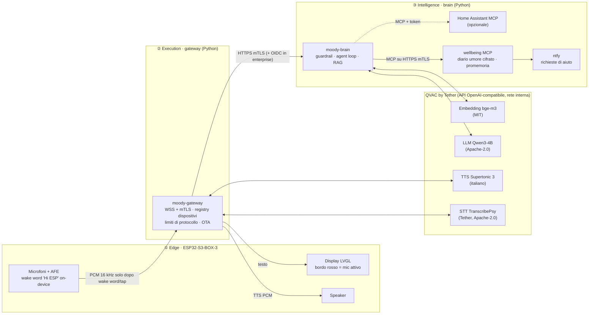
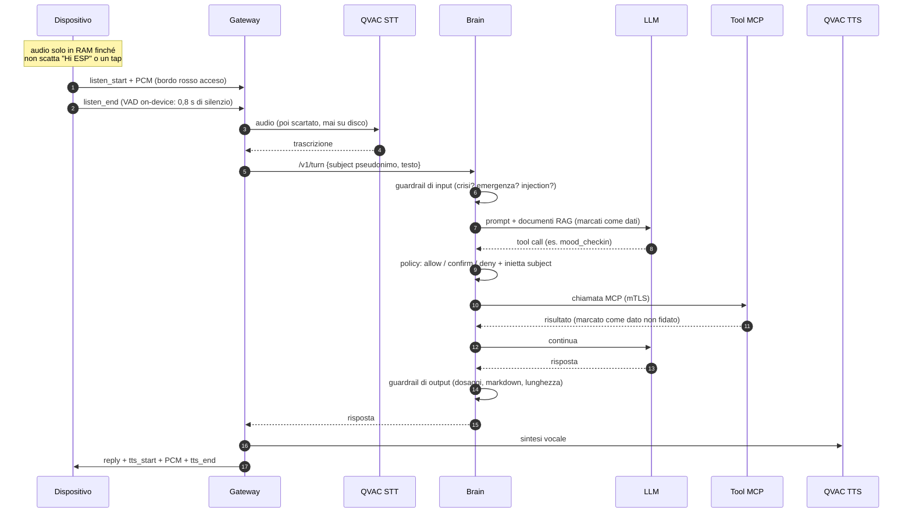
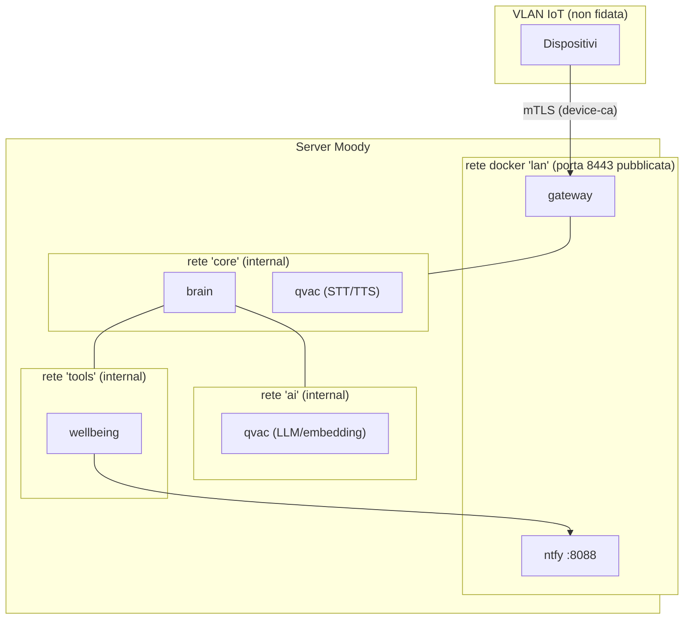

# 00 · Architettura

Moody replica l'architettura a tre livelli del progetto originale (ESP32‑S3 ⇄ sandbox Python ⇄
Microsoft Foundry) e sostituisce ogni componente Microsoft con un equivalente **open source,
self‑hosted e senza cloud**. Questo documento spiega i livelli, la mappatura dei componenti, i flussi
di dati, i confini di fiducia e le scelte progettuali. Tutto è pensato come **wellbeing assistant
privacy & security by design**.

## Prerequisiti

Nessuno: è il documento da leggere per primo.

---

## 1. I tre livelli



| Livello | Originale (Microsoft) | Moody (open source) |
|---|---|---|
| ① Edge | ESP32‑S3 / SenseCAP, wake word "Hi ESP", display, Secure Boot + Flash Encryption | **ESP32‑S3‑BOX‑3**, firmware ESP‑IDF scritto da zero (`firmware/`), ESP‑SR WakeNet9 "Hi ESP", LVGL, Secure Boot V2 + Flash Encryption + NVS encryption, OTA firmata con rollback |
| Trasporto edge | WSS con mutual TLS | **WSS con mutual TLS**, chiave privata generata *sul dispositivo*, CA dedicata ai dispositivi |
| ② Execution | Python sandbox (WebSocket mTLS, accesso controllato alla rete di casa, discovery, MAC, TCP) | **`moody-gateway`**: WebSocket mTLS, registry dispositivi con revoca, pipeline vocale. **Niente scansione di rete né lookup MAC**: l'accesso alla casa passa solo da un server MCP in allow‑list |
| ③ Reasoning | Microsoft Foundry (LLM, agent, orchestrazione tool) | **`moody-brain`** + **[QVAC di Tether](13-qvac.md)** (`qvac serve --openai`) con **Qwen3‑4B** (Apache‑2.0); agent loop minimale e leggibile (`server/moody/brain/agent.py`). Alternative: Ollama (`compose.classic.yaml`) o vLLM |
| Knowledge | Foundry knowledge base | **RAG locale**: Markdown → embedding `bge-m3` (MIT) servito da QVAC → SQLite (`server/moody/brain/rag.py`) |
| Tool / smart home | MCP | **MCP** (SDK ufficiale, MIT): server `wellbeing` incluso + server MCP di Home Assistant |
| Identità | Microsoft Entra ID | **PKI privata a due CA** (`python -m moody.pki`) + **Keycloak** (OIDC client‑credentials) nel profilo enterprise |
| Guardrail | Foundry guardrails / prompt shields | **Guardrail deterministici** (crisi, emergenze, prompt injection, dosaggi) + **IBM Granite Guardian** opzionale (Apache‑2.0) |
| Red teaming | Foundry AI Red Teaming | **Harness proprio** (`redteam/`), **promptfoo** (MIT), **garak** (Apache‑2.0) |
| Speech | (servizi cloud) | **QVAC**: STT **TranscribePsy** (modello di Tether, Apache‑2.0) e TTS **Supertonic 3** (OpenRAIL) via API OpenAI‑compatibile. Alternativa: **faster‑whisper** + **Piper** via **Wyoming** (`compose.classic.yaml`, `compose.piper.yaml`) |
| Notifiche | — | **ntfy** self‑hosted |
| Fabric IQ / Work IQ | integrazioni opzionali | Non replicate di proposito (minimizzazione dei dati). Estensibile con server MCP aggiuntivi |

> ℹ️ **Video streaming**: anche l'originale non lo implementava. Moody lo esclude **per scelta**:
> la BOX‑3 non ha fotocamera e la policy dei tool nega qualsiasi `*camera*`.

---

## 2. Flusso di una conversazione



Se la risposta finisce con una domanda (o è una richiesta di conferma), il dispositivo riapre
l'ascolto per **6 secondi** senza wake word, così l'utente può rispondere "sì"/"no". Ogni nuova
wake word (o tocco) apre invece una **conversazione nuova**: la memoria breve non passa da
un'interazione all'altra.

---

## 3. Confini di fiducia



| Confine | Controllo |
|---|---|
| Dispositivo → gateway | mTLS: il gateway accetta solo certificati della **device CA**; il dispositivo accetta solo il gateway firmato dalla **service CA**. Registry con abilitazione/revoca, ricaricata a caldo |
| Gateway → brain → tool | mTLS con la **service CA**; in enterprise anche token OIDC di Keycloak con audience `moody-brain` |
| LLM → tool | Policy **deny‑by‑default**, livello *confirm*, pattern vietati (serrature, allarmi, camere…), rate limit, **`subject` iniettato lato server** (il modello non può leggere/scrivere dati di un altro residente) |
| Contenuti → LLM | Documenti RAG e output dei tool racchiusi e marcati come **dati**, mai istruzioni |
| Brain/gateway → QVAC | Rete interna, chiave Bearer (`deploy/secrets/qvac_api_key`), `--allowed-host qvac` contro il DNS rebinding, superficie nativa QVAC disattivata (`--no-default`), cache KV su tmpfs (solo RAM) |
| Runtime → Internet | Reti docker `internal: true`: a regime **nessun container AI ha accesso a Internet** (i modelli si scaricano una volta con `scripts/bootstrap-models.sh`; il registry P2P di QVAC si contatta solo in quel momento) |

Due CA separate significano che un certificato rubato da un dispositivo **non può** essere usato
per parlare con il brain o con i tool. Dettagli in [04 · PKI e identità](04-pki-identita.md).

---

## 4. Struttura del repository

```text
firmware/                 Firmware ESP-IDF per ESP32-S3-BOX-3 (C, MIT)
  main/                   state machine, audio (AFE), link mTLS, UI, provisioning, OTA
  tools/provision.py      provisioning via USB (CSR generato sul dispositivo)
  sdkconfig.defaults(.release)
server/                   Pacchetto Python "moody" (MIT): un'immagine, tre servizi
  moody/gateway/          WSS mTLS, registry, pipeline vocale, OTA
  moody/brain/            guardrail, agent loop, LLM client, RAG, policy tool, OIDC
  moody/wellbeing_mcp/    server MCP: umore, promemoria, respirazione, aiuto, cancellazione
  moody/pki.py            PKI privata (due CA, firma CSR, revoca)
  tests/                  test unitari ed end-to-end (mTLS reale)
deploy/                   docker compose (home con QVAC, classic, piper, enterprise, gpu, bootstrap, HA),
                          qvac/ (immagine QVAC), config (qvac, policy, keycloak, ntfy), knowledge
scripts/                  setup.sh, bootstrap-models.sh, ntfy-setup.sh
redteam/                  casi di test avversariali, harness, promptfoo
docs/                     questa documentazione
```

---

## 5. Principi di progetto

1. **Locale prima di tutto**: nessun servizio cloud, nessuna telemetria. L'unico traffico verso
   Internet è il download iniziale dei modelli e gli aggiornamenti che decidi tu.
2. **L'audio non lascia il dispositivo** finché non c'è la wake word o un tocco; nel gateway vive
   solo in RAM e viene scartato subito dopo la trascrizione.
3. **Niente inferenza emotiva**: Moody non analizza voce o comportamento per dedurre emozioni (vedi
   AI Act, art. 5); registra solo l'umore *dichiarato* dalla persona.
4. **Non è un dispositivo medico** e **non sostituisce il 112** né i sistemi di chiamata certificati:
   le frasi di crisi ed emergenza ricevono risposte fisse, scritte e riviste, non improvvisate dal modello.
5. **Pseudonimi ovunque**: nel sistema esiste solo `res-001`; la corrispondenza con la persona sta
   fuori da Moody.
6. **Minimo privilegio**: ogni servizio vede solo le reti, i segreti e i tool che gli servono.
7. **Codice piccolo e leggibile**: niente framework di agent opachi; ogni scelta di sicurezza è nel
   codice ed è coperta da test (`server/tests/`).
8. **Licenze consapevoli**: il repository è MIT e lo stack di default non contiene componenti GPL;
   i componenti con licenze diverse (Supertonic 3 OpenRAIL, Piper GPL‑3.0 negli overlay opzionali)
   girano come processi separati. Vedi [10 · Licenze](10-licenze.md).

---

Prossimo passo → [01 · Lista della spesa](01-acquisto.md)
