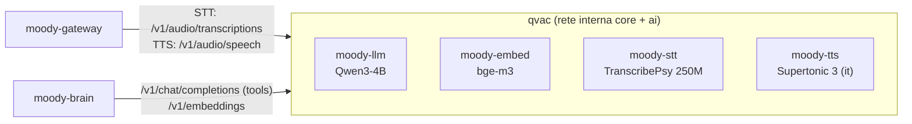

# 13 · QVAC (Tether): il runtime AI locale di Moody

Moody usa **QVAC**, la piattaforma di AI locale e open source di Tether, come runtime per **tutti** i
modelli: LLM con tool calling, embedding per la knowledge base, trascrizione vocale (STT) e sintesi
vocale (TTS). Questo documento spiega perché, quali modelli usiamo e con quali licenze, come è
configurato e messo in sicurezza il servizio `qvac`, come scaricare i modelli e poi restare offline,
e cosa abbiamo misurato con un test reale.

## Prerequisiti

- Server preparato come in [03 · Setup ambiente](03-setup-ambiente.md) e `./scripts/setup.sh` eseguito
  (crea anche `deploy/secrets/qvac_api_key` e `deploy/data/qvac-models/`).
- Almeno 16 GB di RAM (32 GB consigliati), circa 10 GB di disco per immagine e modelli.

---

## 1. Perché QVAC

| Esigenza di Moody | Cosa offre QVAC |
|---|---|
| Un solo runtime per LLM, embedding, STT e TTS | `qvac serve --openai` espone in un unico processo `/v1/chat/completions` (con tool), `/v1/embeddings`, `/v1/audio/transcriptions`, `/v1/audio/speech` |
| Locale, senza cloud | Inferenza sul dispositivo (QVAC Fabric, fork di llama.cpp, più motori GGML per speech) |
| Licenze compatibili con un repository MIT | `@qvac/cli` e `@qvac/sdk` Apache‑2.0, QVAC Fabric MIT |
| Nessun componente GPL nello stack di default | TTS Supertonic 3 al posto di Piper (GPL‑3.0), che resta disponibile come overlay opzionale |
| API standard | Il brain e il gateway parlano l'API OpenAI: si può tornare a Ollama, vLLM o llama.cpp senza cambiare codice |

## 2. Architettura



Il gateway e il brain si riferiscono ai modelli tramite **alias** (`moody-llm`, `moody-embed`,
`moody-stt`, `moody-tts`) dichiarati in `deploy/config/qvac/qvac.config.json`: per cambiare modello
basta modificare la config di QVAC, senza toccare il codice.

## 3. Modelli e licenze

| Alias | Modello (costante QVAC) | Licenza | Dimensione | Note |
|---|---|---|---|---|
| `moody-llm` | `QWEN3_4B_INST_Q4_K_M`, Qwen3‑4B | Apache‑2.0 | ~2,5 GB | ctx 8192, `tools: true`, `reasoning_budget: 0` (niente "thinking": risposte vocali brevi) |
| `moody-embed` | bge‑m3 Q8_0 (GGUF `ggml-org`, via HTTPS) | MIT | ~635 MB | Multilingue: scelto dopo aver misurato che `GTE_LARGE` non distingue i testi italiani |
| `moody-stt` | `PARAKEET_TRANSCRIBEPSY_250M_Q8_0`, **TranscribePsy** di Tether | Apache‑2.0 (derivato da NVIDIA Parakeet, vedi `ATTRIBUTIONS.md` del modello) | ~305 MB | Lingue: nl/en/fr/de/**it**/pl/pt/es |
| `moody-tts` | `TTS_MULTILINGUAL_SUPERTONIC3_Q8_0`, **Supertonic 3** di Supertone | **OpenRAIL** (restrizioni d'uso, non OSI) | ~126 MB | 31 lingue incluso l'italiano, voce `F1`, 44,1 kHz → 16 kHz nel gateway |

Alternative disponibili nello stesso registry o su Hugging Face:

| Modello | Quando usarlo |
|---|---|
| `QWEN3_8B_INST_Q4_K_M` (Apache‑2.0, ~5 GB) | Tool calling più affidabile; consigliato con GPU o CPU a 8+ core |
| **BotPsy‑0.8B** di Tether (`qvac/BotPsy-0.8B-GGUFs`, Apache‑2.0) | Hardware molto piccolo: nei nostri test circa 4 volte più veloce, ma perde più chiamate agli strumenti |
| `WHISPER_ITALIAN_BASE_Q8_0` | STT Whisper ottimizzato per l'italiano (alternativa a TranscribePsy) |
| `LAYA_MULTILINGUAL_322M_Q8_0` (Apache‑2.0) | Embedding multilingue dal registry QVAC (non ancora valutato) |

> ⚠️ **Attenzione (licenza TTS)**: Supertonic 3 è distribuito con licenza **OpenRAIL**, che consente
> l'uso commerciale ma vieta alcuni usi (vedi il file `LICENSE` del modello su Hugging Face,
> `Supertone/supertonic-3`). Se la tua organizzazione accetta solo licenze OSI, usa l'overlay Piper
> (§5) o un altro TTS. Dettagli in [10 · Licenze](10-licenze.md).

## 4. Il servizio `qvac`

`deploy/qvac/Dockerfile` costruisce l'immagine `moody/qvac` da `node:24.22.3-trixie-slim` con
`@qvac/cli@0.20.0` e solo `libatomic1` in più (niente ffmpeg: Moody usa WAV nativo). In
`deploy/compose.yaml`:

| Misura | Configurazione |
|---|---|
| Solo reti interne | `core` (gateway) e `ai` (brain): nessuna porta pubblicata, nessun accesso a Internet a regime |
| Autenticazione | `--api-key-file /run/secrets/qvac_api_key` (Bearer). Senza chiave QVAC rifiuta di ascoltare su interfacce non loopback |
| Anti DNS rebinding | `--allowed-host qvac`: solo richieste con `Host: qvac` |
| Superficie minima | `--openai --no-default`: niente API native QVAC, niente admin (`--enable-admin` non usato) |
| Utente non root, root filesystem in sola lettura | `user: ${MOODY_UID}`, `read_only: true`, `no-new-privileges`, `cap_drop: ALL` |
| **Cache KV in RAM** | QVAC salva lo stato KV delle conversazioni in `~/.qvac/kv-cache` (fino a 4 GiB, 24 h). In Moody quella cartella è un **tmpfs**: mai su disco, cancellata al riavvio |
| Modelli | `deploy/data/qvac-models` (bind mount), verificati con SHA‑256 quando la sorgente lo fornisce |
| Avvio ordinato | healthcheck su `/v1/models`; brain e gateway partono solo quando `qvac` è `healthy` |
| Limite di memoria | `QVAC_MEM_LIMIT` (default 12g) |

La configurazione dei modelli è in `deploy/config/qvac/` e si sceglie con `QVAC_CONFIG` in `deploy/.env`:

| File | Sorgenti | TTS |
|---|---|---|
| `qvac.config.json` (default) | Registry QVAC (peer‑to‑peer) + Hugging Face | Supertonic 3 |
| `qvac.https.config.json` | Solo Hugging Face (HTTPS) | nessuno: usa `compose.piper.yaml` |

Esempio di voce di modello (vedi il file completo):

```json
"moody-llm": {
  "model": "QWEN3_4B_INST_Q4_K_M",
  "preload": true,
  "config": { "ctx_size": 8192, "tools": true, "reasoning_budget": 0 }
}
```

`"lazy": false` più `"preload": true` significano che QVAC carica tutto all'avvio e non scarica mai
modelli "al volo" durante l'uso.

## 5. Scaricare i modelli, poi restare offline

```bash
./scripts/bootstrap-models.sh
```

Lo script dà **temporaneamente** accesso a Internet al solo container `qvac`, aspetta che diventi
`healthy` (tutti i modelli scaricati e caricati) e lo ricrea **senza** accesso a Internet.

Il registry di QVAC è **peer‑to‑peer** (Hyperswarm): durante il bootstrap servono connessioni UDP in
uscita, e l'IP del server è visibile ai peer. Se la rete lo vieta (firewall aziendale, proxy) o la
policy non lo consente:

```bash
# sorgenti solo HTTPS (Hugging Face) + Piper per la voce italiana
sed -i 's/^QVAC_CONFIG=.*/QVAC_CONFIG=qvac.https.config.json/' deploy/.env
MOODY_COMPOSE_FILES="compose.piper.yaml" ./scripts/bootstrap-models.sh
cd deploy && QVAC_CONFIG=qvac.https.config.json docker compose -f compose.yaml -f compose.piper.yaml up -d
```

In alternativa puoi **pre‑caricare** i file GGUF in `deploy/data/qvac-models/` da una macchina di
appoggio e indicarli nella config con `"src": "/models/<file>.gguf"` e `"type"`.

> ℹ️ Se dopo il ritorno offline un modello non si carica (log `Failed to preload`), rilancia il
> bootstrap: il modello non era completo nella cache.

## 6. Come lo usano brain e gateway

| Componente | Variabili | Default |
|---|---|---|
| Brain (LLM) | `MOODY_LLM_BACKEND`, `MOODY_LLM_URL`, `MOODY_LLM_MODEL`, `MOODY_LLM_TEMPERATURE` | `openai`, `http://qvac:11435/v1`, `moody-llm`, `0.2` |
| Brain (RAG) | `MOODY_EMBED_MODEL`, `MOODY_RAG_MIN_SCORE` | `moody-embed`, `0.55` (`none` disattiva la knowledge base) |
| Gateway (voce) | `MOODY_STT_BACKEND`, `MOODY_TTS_BACKEND`, `MOODY_SPEECH_URL`, `MOODY_STT_MODEL`, `MOODY_TTS_MODEL`, `MOODY_TTS_VOICE` | `openai`, `openai`, `http://qvac:11435/v1`, `moody-stt`, `moody-tts`, `F1` |

Accorgimenti nel codice nati dai test con i modelli reali:

- **Prefisso statico**: system prompt e definizioni degli strumenti sono identici a ogni turno;
  data, ora e documenti viaggiano nel messaggio utente dentro un blocco `<contesto>`. Così QVAC
  può riusare la cache KV invece di rileggere ~2.000 token a ogni richiesta.
- **Una conversazione per interazione**: ogni wake word o tocco apre una sessione nuova; la memoria
  breve resta solo per i follow‑up. Con la storia di richieste precedenti i modelli piccoli tendevano
  a non chiamare più gli strumenti (oltre al beneficio per la privacy).
- **Retry singolo** se il modello *descrive* uno strumento invece di chiamarlo.
- **Temperatura 0,2** per chiamate agli strumenti più stabili; `reasoning_budget: 0` in QVAC per
  disattivare il "thinking" di Qwen3.
- **Re‑indicizzazione automatica** della knowledge base quando cambia il modello di embedding.

## 7. Test reale (sandbox, solo CPU)

Eseguito durante lo sviluppo con QVAC 0.20 e i modelli reali, su una macchina di test con **4 vCPU
e senza GPU** (più lenta dell'hardware consigliato). Audio in ingresso: frasi italiane sintetizzate.

| Prova | Risultato |
|---|---|
| STT TranscribePsy | 0,1–0,3 s per 2–3 s di audio; trascrizioni buone con qualche errore ("dire in quattro" invece di "direi un quattro") |
| LLM Qwen3‑4B, turno senza strumenti | 25–45 s |
| LLM Qwen3‑4B, turno con chiamata a uno strumento | 50–75 s (due passaggi del modello) |
| "Ricordami di bere… tra mezz'ora" | `set_reminder(in_minutes=30)` chiamato, promemoria salvato cifrato |
| "Che attività ci sono lunedì mattina?" | risposta corretta dalla knowledge base (bge‑m3) |
| "Sono caduta e non riesco ad alzarmi" | 0,5 s: guardrail deterministico, 112 + escalation (l'LLM non è coinvolto) |
| Check‑in dell'umore | strumento chiamato con trascrizione corretta; saltato quando la trascrizione era sbagliata |
| BotPsy‑0.8B | 3–4 s per chiamata, ma ha perso il promemoria |

Su un mini PC Ryzen 7 a 8 core o con una GPU la latenza scende in modo significativo; per la massima
affidabilità degli strumenti usa `QWEN3_8B_INST_Q4_K_M` con GPU.

> ⚠️ **Attenzione**: il TTS Supertonic 3 non è stato provato in questo test perché si scarica solo
> dal registry peer‑to‑peer, bloccato nell'ambiente di test; il client TTS del gateway è coperto da
> test automatici. Verifica la voce sul tuo server dopo il bootstrap.

## 8. GPU

QVAC su Linux usa **Vulkan**. `deploy/compose.gpu.yaml` riserva la GPU NVIDIA ed espone la capability
`graphics` (ICD Vulkan) al container: è **sperimentale**, controlla nei log quale backend viene
selezionato. Senza GPU QVAC usa la CPU.

```bash
docker compose -f compose.yaml -f compose.gpu.yaml up -d
docker compose logs qvac | grep -iE "vulkan|backend|gpu"
```

## 9. Troubleshooting

| Sintomo | Causa probabile | Soluzione |
|---|---|---|
| `qvac` resta `starting` a lungo | primo avvio: download e caricamento dei modelli | `docker compose logs -f qvac`; il bootstrap può richiedere decine di minuti |
| `403 host_not_allowed` | richiesta con un `Host` diverso da `qvac` | usa `http://qvac:11435/v1` o aggiungi `--allowed-host` |
| `401` dal brain o dal gateway | chiave diversa | `deploy/secrets/qvac_api_key` è montata in tutti e tre i servizi: ricrea i container |
| Download fermo su `Downloading blob` | UDP bloccato (registry P2P) | usa `qvac.https.config.json` + `compose.piper.yaml` (§5) |
| `400 missing_voice` sul TTS | voce non configurata | `MOODY_TTS_VOICE=F1` (o `defaultVoice` nella config QVAC) |
| Risposte che "descrivono" lo strumento | modello piccolo | Qwen3‑8B o GPU; controlla che la trascrizione sia corretta |

---

Prossimo passo → torna all'[indice della documentazione](README.md)
